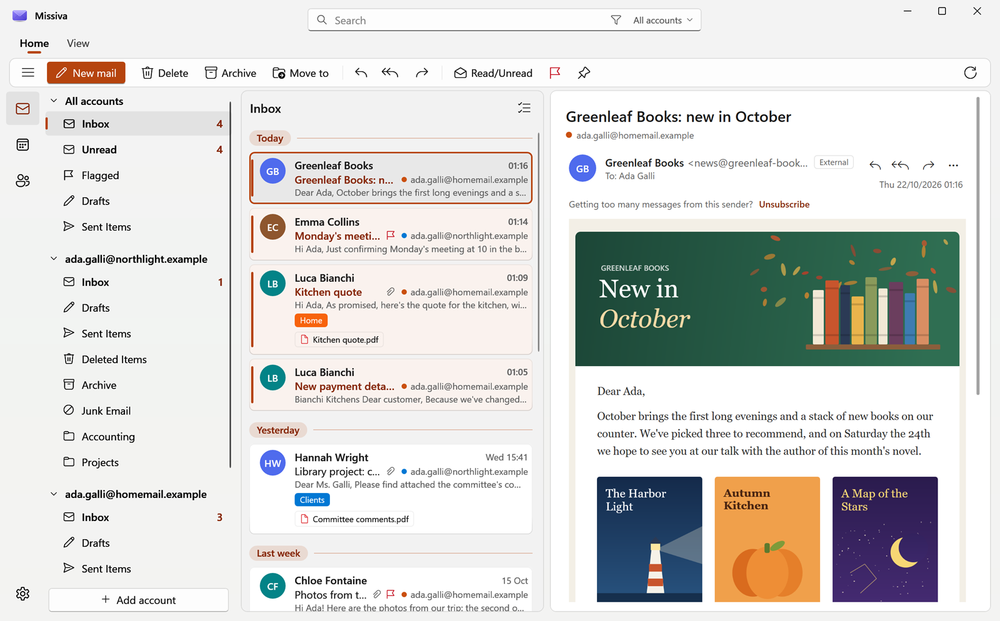
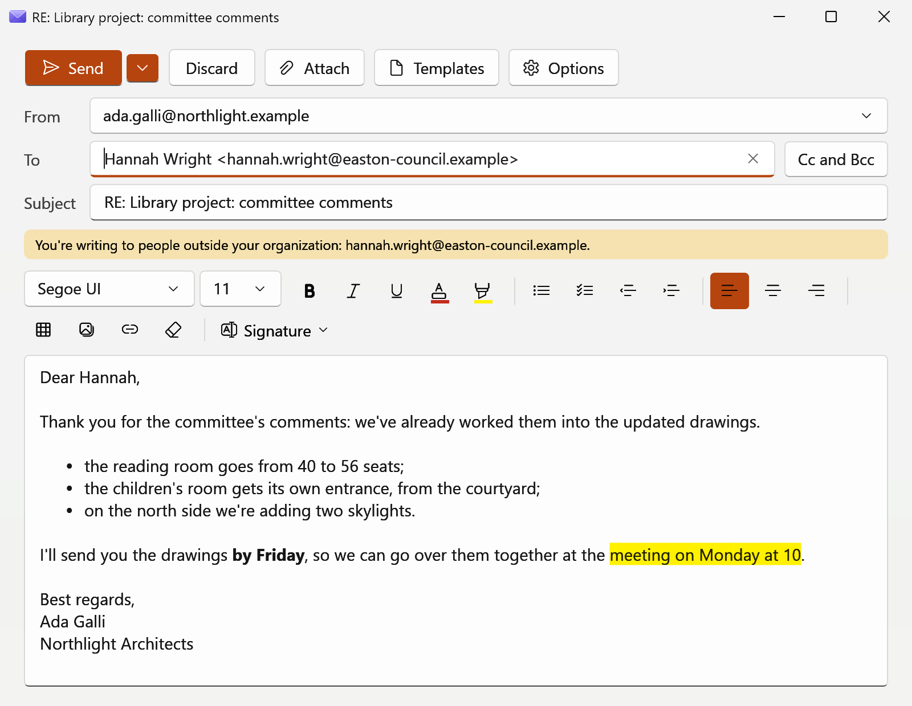
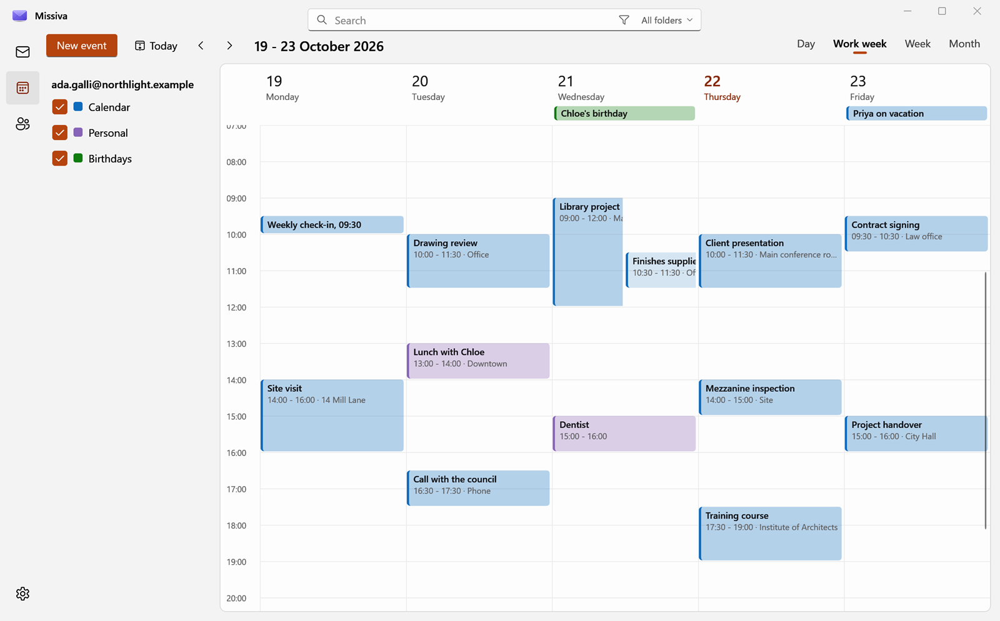
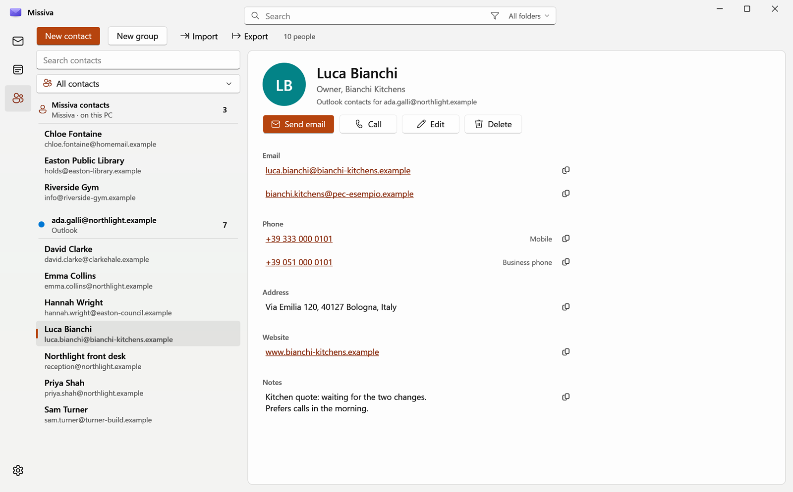
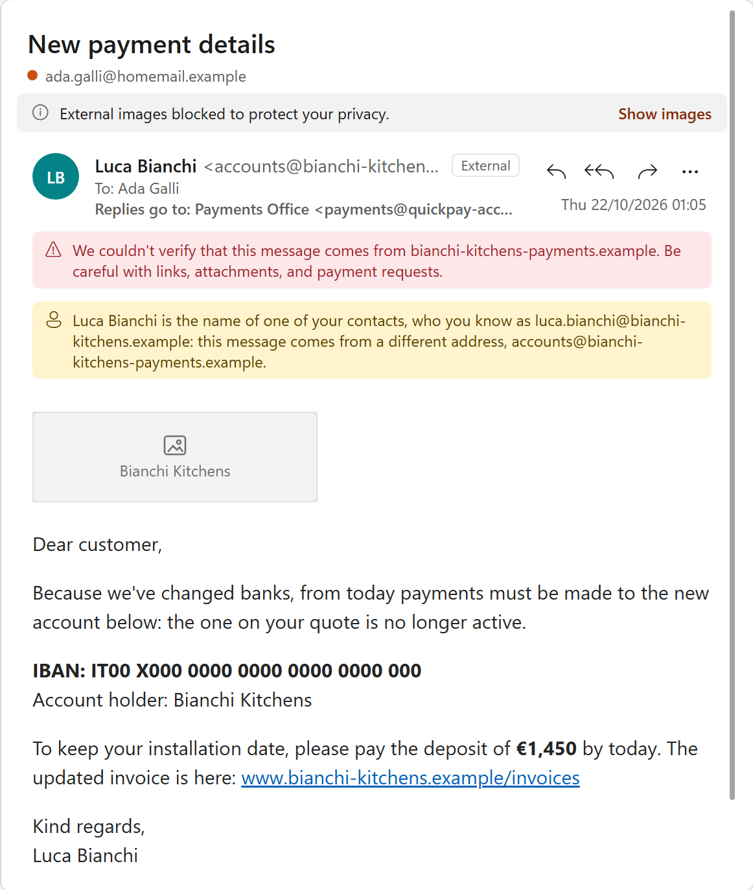
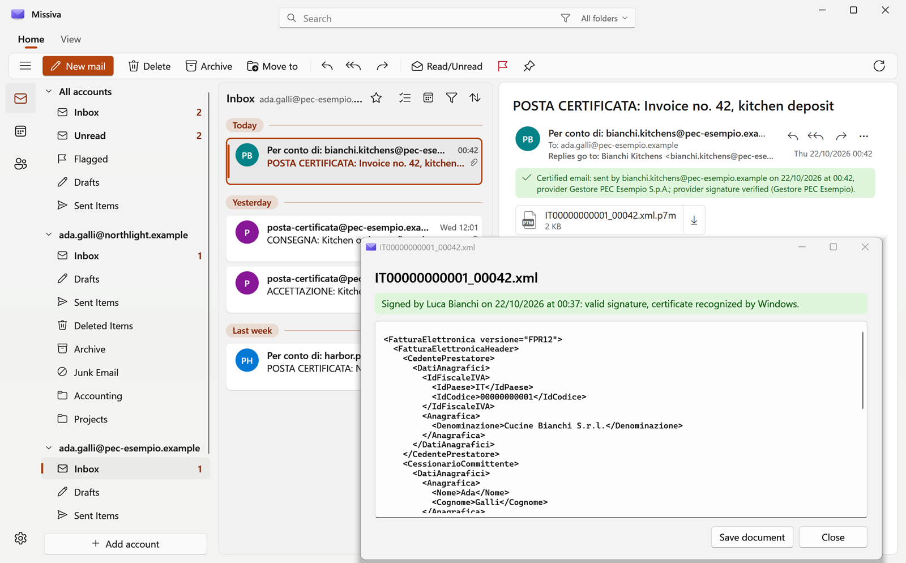

<p align="center">
  
</p>

<h1 align="center">Missiva</h1>

<p align="center">
  <strong>Email on Windows 11, like the new Outlook but native: fast, light, no ads, and no one else's servers in
  between.</strong>
</p>

<p align="center">
  <a href="../../releases/latest"><strong>Download</strong></a>
  &nbsp;·&nbsp;
  <a href="MANUAL.md"><strong>Manual</strong></a>
  &nbsp;·&nbsp;
  <a href="#security-and-privacy"><strong>Security</strong></a>
  &nbsp;·&nbsp;
  <a href="README.md"><strong>Italiano</strong></a>
</p>

<picture>
  <source media="(prefers-color-scheme: dark)" srcset="docs/immagini/en/main-dark.png">
  
</picture>

<p align="center"><sub>All pictures come from the test build, with made-up accounts, people and messages.</sub></p>

Missiva is available in English and Italian: it follows the Windows display language, and you can change it in
Settings, General, Appearance, Language.

## Why not the new Outlook

- **A Windows program, not a web page.** The new Outlook is the Outlook on the web experience inside WebView2[^1].
  Missiva is written for Windows 11, with the Windows Fluent style, and uses WebView2 only to lay out the content of
  emails.
- **Light.** Measured on the author's PC with the release build: the window appears about 0.7 seconds after launch
  (with the PC already on); after startup Missiva uses about 130 MB of memory, plus about 100 MB for the engine that
  lays out emails. Closed to the notification area, where it keeps checking mail, it drops to about 80 MB.
- **Your mail doesn't go through anyone else.** Missiva talks directly to Microsoft, to Gmail or to your mailbox's
  server, from your PC, and has no servers of its own. The new Outlook, with a Gmail, Yahoo, iCloud or IMAP account,
  offers to sync it with the Microsoft cloud: mail, contacts and events go through a Microsoft data center[^2].
- **No ads.** The new Outlook, with a free personal account, shows ads in the Inbox, which go away with a
  subscription[^3]. Missiva has no ads and no subscriptions.
- **Senders don't know when you read.** Emails open without JavaScript and without remote images until you allow
  them. Missiva warns you when the sender isn't verified, when a name you know arrives from a different address, and
  when a link leads to a site other than the one it shows.
- **Made for Italy too.** It reads Italian certified email (PEC) and checks its signature; it opens and verifies
  signed .p7m files, such as Italian e-invoices.
- **Open source.** MIT license. The security and code audits are public, with the outcome of every point.

[^1]: Microsoft, overview of the new Outlook for Windows: https://learn.microsoft.com/en-us/microsoft-365-apps/outlook/overview-new-outlook-windows
[^2]: Notebookcheck, the new Outlook and Gmail, Yahoo, iCloud and IMAP accounts: https://www.notebookcheck.net/The-new-Outlook-gives-Microsoft-access-to-Gmail-Yahoo-iCloud-and-IMAP-accounts.766980.0.html
[^3]: Microsoft, the Outlook for Windows page: https://www.microsoft.com/en-us/microsoft-365/outlook/outlook-for-windows

## What it can do

The full manual, with what Missiva does and what is still missing, is in [MANUAL.md](MANUAL.md).

### Mail

- Microsoft accounts (Outlook.com, Hotmail, Live, Microsoft 365 work or school), Gmail and Google Workspace, and any
  IMAP and SMTP mailbox (your provider's, or mail on your own domain). Add account recognizes the type of account
  from the address.
- All accounts in a single Inbox, each row with the color of its account. Categories, flags with due dates and
  reminders, pinned messages, Snooze, rules.
- Search in one folder, in all folders or in all accounts, with filters (from, to, subject, dates, attachments) and
  suggestions as you type.
- New messages arrive right away (with Gmail and IMAP the server announces them, with Microsoft Missiva asks every 30
  seconds), with Windows notifications: Reply, Flag and Delete from the notification.
- Preview of PDF, image and text attachments, without opening other programs. Light or dark theme, like Windows.
- When you close the window, Missiva stays in the notification area and keeps checking mail.

### Writing



- Text formatting like the new Outlook: font, colors, lists, indents, tables, images and links, with spell checking
  in the language of Missiva.
- Drafts save themselves; Undo send for a few seconds after Send; Schedule send; signatures per account and templates
  for text you write again and again.
- Recipient suggestions as you type, a warning when you write outside your organization, and one for the forgotten
  attachment.

### Calendar and contacts

For Microsoft and Google accounts.



- Day, work week, week and month; new events and meetings with invitations, replies to invitations, events you move
  by dragging them.
- People: each contact's card, with Send email, Call, Edit; vCard and CSV import and vCard export. For the other
  accounts contacts live in Missiva, encrypted on the PC.



### Offline

- Messages you have already opened and those in the Inbox from the last 30 days can be read offline, from an encrypted
  copy on the PC, and search looks there.
- Delete, Archive, Move, Mark as read and Flag done offline go out when the network comes back; a message you send
  waits in the Outbox.

### Security



- No code in emails ever runs, and the reading pane never connects to the Internet on its own.
- A red bar when your mailbox's server couldn't verify the sender; a yellow one when the name belongs to someone you
  have written to but the address is a different one; the line "Replies go to" when replies go elsewhere; "External"
  for senders outside your organization.
- A warning before opening a link that leads to a site other than the one it shows. Attachments that can start
  programs ask for confirmation.

### Certified email and digital signatures

Italian certified email (PEC) is a registered-mail service with legal value in Italy: the provider wraps each message
in a signed envelope and sends receipts.



- The provider's envelope opens by itself: you read the real message, under a bar that says who sent it, when, through
  which provider and how the signature is. Green if Windows recognizes the provider's certificate, yellow (the most
  common case) if the signature is intact but Windows doesn't know the certificate, red if the envelope was altered.
  In the picture it's green because the test build recognizes a test certificate.
- Acceptance and delivery receipts read as one line; failed deliveries are in red, with the reason.
- .p7m files (e-invoices, signed documents) open in Missiva with the signer, the date and the state of the signature;
  invoices read as text.

### Backup

- A single file, encrypted with a password, to take settings, accounts, signatures, rules and contacts to another PC.

## Install

### From a release

You need Windows 11, and nothing else.

1. From the [latest release](../../releases/latest) download `Missiva-0.3.N.zip`.
2. Extract the zip to a folder.
3. In File Explorer, right-click inside that folder, choose Open in Terminal, and run:

   ```
   powershell -ExecutionPolicy Bypass -File installa.ps1
   ```

The script checks that the program starts and puts it in `%LOCALAPPDATA%\Programs\Missiva`, without administrator
rights. Missiva appears in the Start menu and in Settings, Apps, Installed apps, where you can uninstall it.

Missiva doesn't have a code signing certificate: the first time you open it, Windows may warn that it "protected your
PC". Select More info, then Run anyway.

From then on **it updates itself**: when a new version comes out a button in the title bar says so, and Update
downloads it, checks it and reopens Missiva up to date. It only accepts updates signed with the key of whoever
publishes Missiva: how it works is in [docs/aggiornamenti.en.md](docs/aggiornamenti.en.md).

### From source

You need the [.NET 10 SDK](https://dotnet.microsoft.com/download) and PowerShell 7 (`winget install Microsoft.PowerShell`).
From the source folder:

```
pwsh -ExecutionPolicy Bypass -File installa.ps1
```

Built this way, Missiva doesn't update itself: to update it, run the same command again; settings and accounts stay.

To open email links (mailto:) on web pages with Missiva, after installing choose it in Settings, Apps, Default apps,
Missiva: Windows doesn't let programs do it themselves.

## Add an account

Add account starts from the address: Missiva recognizes the type of account and suggests it.

- **Outlook.com, Hotmail, Live**: Sign in with Microsoft, and the Windows account window opens. Nothing else to do.
- **Microsoft 365 work or school**: the same. If your organization doesn't let users consent to apps, Missiva
  explains it and prepares the link to send to your administrator. Details are in [MANUAL.md](MANUAL.md).
- **Gmail and Google Workspace**: the first time you register your own app on Google Cloud, free and in about ten
  minutes. The step-by-step guide is in [docs/gmail.en.md](docs/gmail.en.md).
- **Other mailboxes (IMAP and SMTP)**: address and password; Missiva looks up the servers and shows them before
  signing in.

## Project status

- Version 0.3. It's a personal project, used every day by the author: it works, but comes with no warranty and no
  support.
- In English and Italian, only for Windows 11.
- The program isn't signed with a code signing certificate: Windows warns the first time you open it.
- The calendar is there for Microsoft and Google accounts, not yet for the others. What's missing is in
  [MANUAL.md](MANUAL.md#whats-still-missing).

## Security and privacy

- No code in emails ever runs: JavaScript is off in the reading pane, and scripts, frames and forms are removed from
  the email before showing it.
- The reading pane never connects to the Internet on its own: only the images of senders for whom you selected Show
  images get through. This way the sender doesn't know if and when you read.
- Passwords and sign-ins stay on the PC, encrypted with Windows data protection. Missiva has no servers: it talks to
  your mail servers and, on its own, only to fetch the logos of the companies you get mail from and, if you installed
  it from a release, to check for updates on GitHub. Both can be turned off in Settings.

To learn more:

- [docs/aggiornamenti.en.md](docs/aggiornamenti.en.md): how it updates, what it checks before accepting an update,
  what GitHub sees.
- [docs/audit](docs/audit): the security, speed, code and feature audits done on Missiva, and in
  [ESITO.md](docs/audit/ESITO.md) what became of each point: confirmed or not, fixed or left, with the measurements.
  The audits are in Italian.
- The Security section of the manual, in [MANUAL.md](MANUAL.md#security).

## For those reading the code

- `Core` is the mail (Microsoft Graph, Gmail and IMAP, HTML cleanup, the copy on the PC), `UI` the WPF interface,
  `strumenti` the scripts to test it. Code comments are in Italian.
- Italian is the source language: every interface text is written in Italian in the code, inside `T("...")`, and its
  English translation is in `Assets/lingue/en`. A test checks that every text has its translation.
- The automated tests live in `Core/ProvaBozze*.cs` and run inside the Debug build, with fake servers on the PC and
  no network: `dotnet build`, then `Missiva.exe --prova-bozze risultato.txt` with the `MISSIVA_DATA` variable pointing
  to an empty folder. Without that variable the Debug build doesn't start, so it never touches real mail.
- The pictures on this page are made by `strumenti/foto-pagina.ps1 -Lingua en`, with the Debug build and the fake
  mailboxes of `Core/ProvaBozze.Foto.cs`.
- The audits in `docs/audit` are public on purpose. They mention some working notes (`CLAUDE.md`, `docs/storia`) that
  are not in this repository.

## License

Missiva is released under the MIT license: the text is in [LICENSE](LICENSE). In short, you can use, modify and
redistribute it freely, keeping the copyright notice, and it comes as is, without warranty.

The third-party components Missiva uses, with their licenses, are in [TERZE-PARTI.md](TERZE-PARTI.md).
