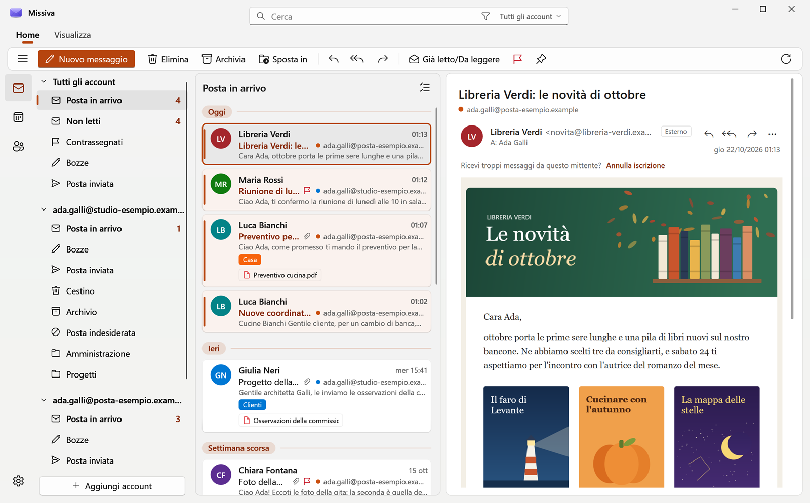
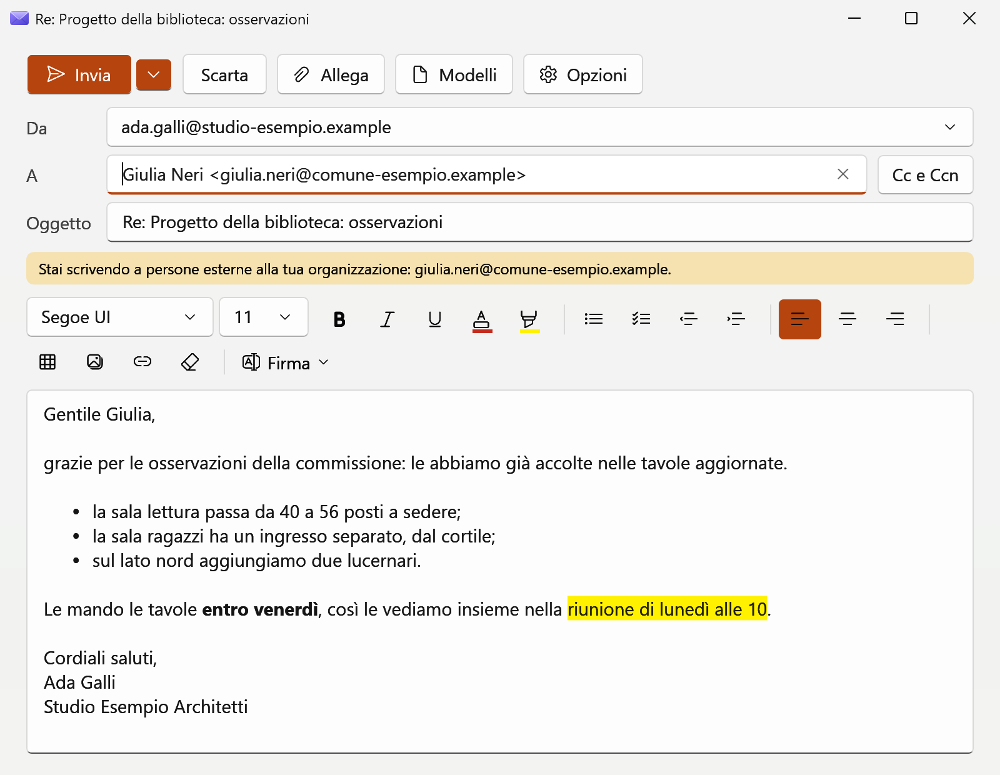
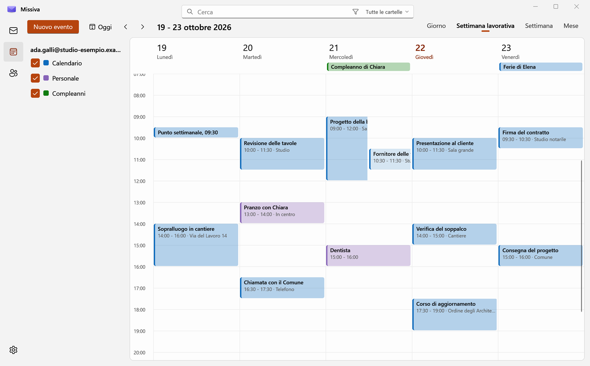
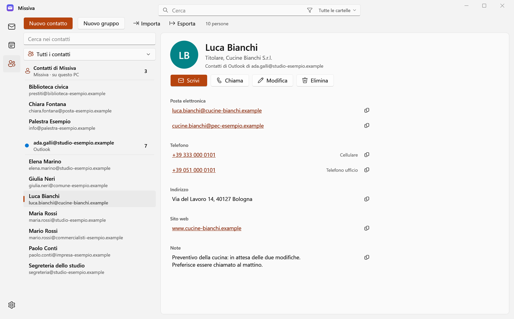
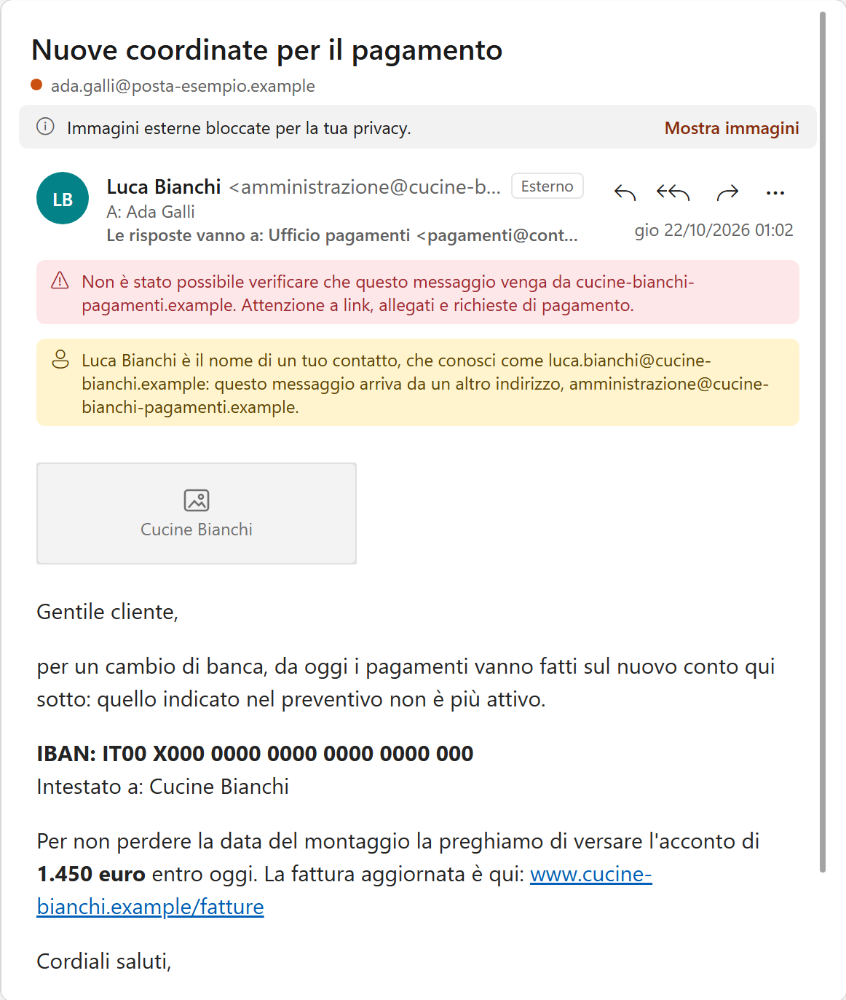
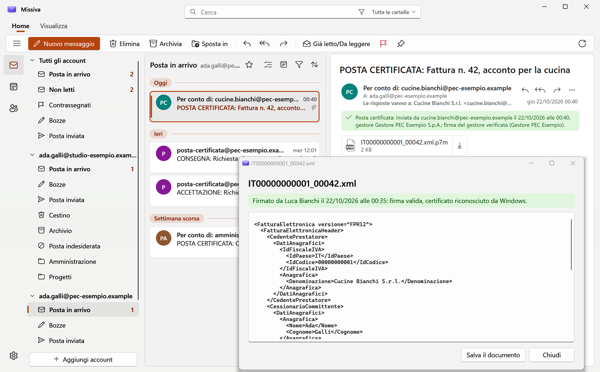

<p align="center">
  
</p>

<h1 align="center">Missiva</h1>

<p align="center">
  <strong>La posta su Windows 11, come il nuovo Outlook ma nativa: veloce, leggera, senza pubblicità e senza passare
  dai server di nessuno.</strong>
</p>

<p align="center">
  <a href="../../releases/latest"><strong>Scarica</strong></a>
  &nbsp;·&nbsp;
  <a href="LEGGIMI.md"><strong>Manuale</strong></a>
  &nbsp;·&nbsp;
  <a href="#sicurezza-e-privacy"><strong>Sicurezza</strong></a>
</p>

<picture>
  <source media="(prefers-color-scheme: dark)" srcset="docs/immagini/principale-scuro.png">
  
</picture>

<p align="center"><sub>Tutte le immagini sono della versione di prova, con account, persone e messaggi inventati.</sub></p>

**In English.** Missiva is a native Windows 11 email client, modeled on the new Outlook but built with WPF instead of
a web page. It talks directly to Outlook.com and Microsoft 365, Gmail and any IMAP/SMTP mailbox from your PC, with no
ads and no servers of its own in between. Emails open in a locked-down WebView2, without JavaScript and without remote
images until you allow them. It also reads Italian certified email (PEC) and signed .p7m e-invoices. The interface is
in Italian. Open source, MIT license.

## Perché non il nuovo Outlook

- **Un programma di Windows, non una pagina web.** Il nuovo Outlook è l'esperienza di Outlook sul web dentro
  WebView2[^1]. Missiva è scritta per Windows 11, con lo stile Fluent di Windows, e usa WebView2 solo per impaginare
  il contenuto delle email.
- **Leggera.** Misurati sul PC dell'autore, con la versione finale: la finestra compare in circa 0,7 secondi
  dall'avvio (a PC già acceso); dopo l'avvio Missiva occupa circa 130 MB di memoria, più circa 100 MB del motore che
  impagina le email. Chiusa nell'area di notifica, dove continua a controllare la posta, scende a circa 80 MB.
- **La tua posta non passa da altri.** Missiva parla direttamente con Microsoft, con Gmail o con il server della tua
  casella, dal tuo PC, e non ha server suoi. Il nuovo Outlook, con un account Gmail, Yahoo, iCloud o IMAP, propone di
  sincronizzarlo con il cloud di Microsoft: posta, contatti ed eventi passano da un centro dati di Microsoft[^2].
- **Niente pubblicità.** Il nuovo Outlook, con un account personale gratuito, mostra annunci nella Posta in
  arrivo, che si tolgono con un abbonamento[^3]. Missiva non ha annunci né abbonamenti.
- **Chi ti scrive non sa quando leggi.** Le email si aprono senza JavaScript e senza immagini esterne finché non le
  consenti. Missiva avvisa quando il mittente non è verificato, quando un nome che conosci arriva da un altro indirizzo
  e quando un link porta a un sito diverso da quello che mostra.
- **Fatta anche per l'Italia.** Legge la posta certificata (PEC) e ne controlla la firma; apre e verifica i file
  firmati .p7m, come le fatture elettroniche.
- **Codice aperto.** Licenza MIT. Gli audit di sicurezza e del codice sono pubblici, con l'esito di ogni punto.

[^1]: Microsoft, panoramica del nuovo Outlook per Windows: https://learn.microsoft.com/en-us/microsoft-365-apps/outlook/overview-new-outlook-windows
[^2]: Notebookcheck, il nuovo Outlook e gli account Gmail, Yahoo, iCloud e IMAP: https://www.notebookcheck.net/The-new-Outlook-gives-Microsoft-access-to-Gmail-Yahoo-iCloud-and-IMAP-accounts.766980.0.html
[^3]: Microsoft, la pagina di Outlook per Windows: https://www.microsoft.com/en-us/microsoft-365/outlook/outlook-for-windows

## Che cosa sa fare

Il manuale completo, con quello che Missiva fa e quello che ancora manca, è in [LEGGIMI.md](LEGGIMI.md).

### Posta

- Account Microsoft (Outlook.com, Hotmail, Live, Microsoft 365 di lavoro o della scuola), Gmail e Google Workspace, e
  ogni casella IMAP e SMTP (Aruba, Register.it, OVH, Zoho, posta su dominio proprio). Aggiungi account riconosce da
  solo il tipo di account dall'indirizzo.
- Tutti gli account in una sola Posta in arrivo, ogni riga con il colore del suo account. Categorie, contrassegni con
  scadenza e promemoria, messaggi fissati in cima, Posponi, regole.
- Ricerca in una cartella, in tutte o in tutti gli account, con i filtri (da, a, oggetto, date, allegati) e i
  suggerimenti mentre scrivi.
- I nuovi messaggi arrivano subito (con Gmail e IMAP li annuncia il server, con Microsoft Missiva chiede ogni 30
  secondi), con le notifiche di Windows: Rispondi, Contrassegna ed Elimina dalla notifica.
- Anteprima di PDF, immagini e testi allegati, senza aprire altri programmi. Tema chiaro o scuro, come Windows.
- Chiudendo la finestra Missiva resta nell'area di notifica e continua a controllare la posta.

### Scrittura



- Formato del testo come nel nuovo Outlook: carattere, colori, elenchi, rientri, tabelle, immagini e link, con il
  controllo ortografico italiano.
- Le bozze si salvano da sole; Annulla invio per qualche secondo dopo Invia; Pianifica invio; firme per account e
  modelli per i testi che si ripetono.
- I suggerimenti dei destinatari mentre scrivi, l'avviso quando scrivi fuori dalla tua organizzazione e quello
  dell'allegato dimenticato.

### Calendario e contatti

Per gli account Microsoft e Google.



- Giorno, settimana lavorativa, settimana e mese; nuovi eventi e riunioni con gli inviti, risposte agli inviti,
  eventi da spostare trascinandoli.
- Persone: la scheda di ogni contatto, con Scrivi, Chiama, Modifica; si importano vCard e CSV e si esporta in vCard.
  Per gli altri account i contatti stanno in Missiva, cifrati sul PC.



### Senza rete

- I messaggi già aperti e quelli della Posta in arrivo degli ultimi 30 giorni si leggono anche senza rete, da una copia
  cifrata sul PC, e la ricerca cerca lì.
- Elimina, Archivia, Sposta, Già letto e Contrassegna fatti senza rete partono quando la rete torna; un messaggio
  inviato aspetta nella Posta in uscita.

### Sicurezza



- Nessun codice delle email viene eseguito, e il riquadro di lettura non si collega a Internet da solo.
- Una fascia rossa quando il server della tua casella non ha potuto verificare il mittente; una gialla quando il nome è
  di una persona a cui hai scritto ma l'indirizzo è un altro; la riga "Le risposte vanno a" quando le risposte vanno
  altrove; "Esterno" per chi scrive da fuori dalla tua organizzazione.
- Un avviso prima di aprire un link che porta a un sito diverso da quello che mostra. Gli allegati che possono avviare
  programmi chiedono conferma.

### Posta certificata e firme digitali



- La busta del gestore si apre da sola: si legge il messaggio vero, sotto una fascia che dice chi l'ha mandato,
  quando, con quale gestore e com'è la firma. Verde se Windows riconosce il certificato del gestore, gialla (il caso
  più comune) se la firma è integra ma Windows non conosce il certificato, rossa se la busta è stata alterata. Nella
  foto è verde perché la versione di prova riconosce un certificato di prova.
- Le ricevute di accettazione e di consegna si leggono in una riga; le mancate consegne sono in rosso, con il motivo.
- I file .p7m (fatture elettroniche, documenti firmati) si aprono in Missiva con il firmatario, la data e lo stato
  della firma; le fatture si leggono come testo.

### Copia di sicurezza

- Un file solo, cifrato con una password, per portare impostazioni, account, firme, regole e contatti su un altro PC.

## Installare

### Da un rilascio

Serve Windows 11, e nient'altro.

1. Dall'[ultimo rilascio](../../releases/latest) scarica `Missiva-0.3.N.zip`.
2. Estrai lo zip in una cartella.
3. In Esplora file, con il tasto destro dentro quella cartella, scegli Apri nel Terminale, e lancia:

   ```
   powershell -ExecutionPolicy Bypass -File installa.ps1
   ```

Lo script prova che l'eseguibile parta e lo mette in `%LOCALAPPDATA%\Programs\Missiva`, senza permessi di
amministratore. Missiva compare nel menu Start e in Impostazioni, App installate, da dove si disinstalla.

Missiva non ha un certificato di firma del codice: la prima volta che la apri Windows può avvisare che "ha protetto il
PC". Premi Ulteriori informazioni, poi Esegui comunque.

Da lì **si aggiorna da sola**: quando esce una versione nuova un pulsante nella barra del titolo lo dice, e Aggiorna la
scarica, la controlla e riapre Missiva aggiornata. Accetta solo aggiornamenti firmati con la chiave di chi
pubblica Missiva: come funziona è in [docs/aggiornamenti.md](docs/aggiornamenti.md).

### Dai sorgenti

Servono [.NET 10 SDK](https://dotnet.microsoft.com/download) e PowerShell 7 (`winget install Microsoft.PowerShell`).
Dalla cartella dei sorgenti:

```
pwsh -ExecutionPolicy Bypass -File installa.ps1
```

Compilata così Missiva non si aggiorna da sola: per aggiornarla si rilancia lo stesso comando, e impostazioni e
account restano.

Per aprire con Missiva i link di posta (mailto:) delle pagine web, dopo l'installazione sceglila in Impostazioni, App,
App predefinite, Missiva: Windows non lascia farlo ai programmi.

## Aggiungere un account

Aggiungi account parte dall'indirizzo: Missiva riconosce da sola il tipo di account e lo propone.

- **Outlook.com, Hotmail, Live**: Accedi con Microsoft, si apre la finestra account di Windows. Nient'altro da fare.
- **Microsoft 365 di lavoro o della scuola**: lo stesso. Se l'organizzazione non lascia agli utenti il consenso alle
  app, Missiva lo spiega e prepara il link da mandare all'amministratore. I dettagli sono in [LEGGIMI.md](LEGGIMI.md).
- **Gmail e Google Workspace**: la prima volta si registra una propria app su Google Cloud, gratis e in una decina di
  minuti. La guida passo per passo è in [docs/gmail.md](docs/gmail.md).
- **Altre caselle (IMAP e SMTP)**: indirizzo e password; Missiva cerca da sola i server e li mostra prima
  dell'accesso.

## Stato del progetto

- Versione 0.3. È un progetto personale, usato tutti i giorni dall'autore: funziona, ma non ha garanzie né
  assistenza.
- Solo in italiano, solo per Windows 11.
- L'eseguibile non è firmato con un certificato di firma del codice: Windows avvisa alla prima apertura.
- Il calendario c'è per gli account Microsoft e Google, non ancora per gli altri. Quello che manca è in
  [LEGGIMI.md](LEGGIMI.md#cosa-manca-ancora).

## Sicurezza e privacy

- Nessun codice delle email viene eseguito: JavaScript è spento nel riquadro di lettura, e script, frame e moduli
  sono tolti dall'email prima di mostrarla.
- Il riquadro non si collega a Internet da solo: passano solo le immagini dei mittenti per cui hai premuto Mostra
  immagini. Così il mittente non sa se e quando hai letto.
- Password e accessi restano sul PC, cifrati con la protezione dati di Windows. Missiva non ha server: parla con i
  server della tua posta e, da sola, solo per il logo delle aziende da cui ricevi posta e, se l'hai installata da un
  rilascio, per controllare gli aggiornamenti su GitHub. Tutte e due le cose si spengono nelle Impostazioni.

Per saperne di più:

- [docs/aggiornamenti.md](docs/aggiornamenti.md): come si aggiorna, che cosa controlla prima di accettare un
  aggiornamento, che cosa vede GitHub.
- [docs/audit](docs/audit): gli audit di sicurezza, di velocità, del codice e delle funzioni fatti su Missiva, e in
  [ESITO.md](docs/audit/ESITO.md) che cosa ne è stato di ogni punto: confermato o no, corretto o lasciato, con le misure.
- La sezione Sicurezza del manuale, in [LEGGIMI.md](LEGGIMI.md#sicurezza).

## Per chi guarda il codice

- `Core` è la posta (Microsoft Graph, Gmail e IMAP, la pulizia dell'HTML, la copia sul PC), `UI` l'interfaccia WPF,
  `strumenti` gli script per provarla.
- Le prove automatiche stanno in `Core/ProvaBozze*.cs` e girano dentro l'eseguibile di Debug, con server finti sul PC
  e senza rete: `dotnet build`, poi `Missiva.exe --prova-bozze risultato.txt` con la variabile `MISSIVA_DATA` che
  indica una cartella vuota. Senza quella variabile la versione di Debug non parte, per non toccare la posta vera.
- Le immagini di questa pagina le fa `strumenti/foto-pagina.ps1`, con la versione di Debug e le caselle finte di
  `Core/ProvaBozze.Foto.cs`.
- Gli audit in `docs/audit` sono pubblici apposta. Citano alcuni appunti di lavoro (`CLAUDE.md`, `docs/storia`) che in
  questo repository non ci sono.

## Licenza

Missiva è distribuita con la licenza MIT: il testo è in [LICENSE](LICENSE). In breve, puoi usarla, modificarla e
ridistribuirla liberamente, lasciando la nota di copyright, e viene fornita così com'è, senza garanzie.

I componenti di terzi che Missiva usa, con le loro licenze, sono in [TERZE-PARTI.md](TERZE-PARTI.md).
